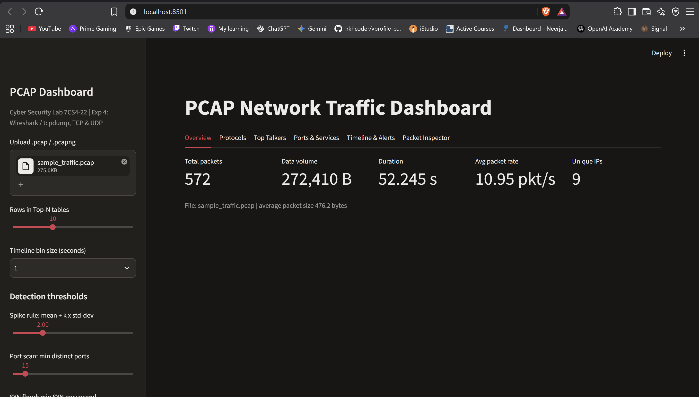
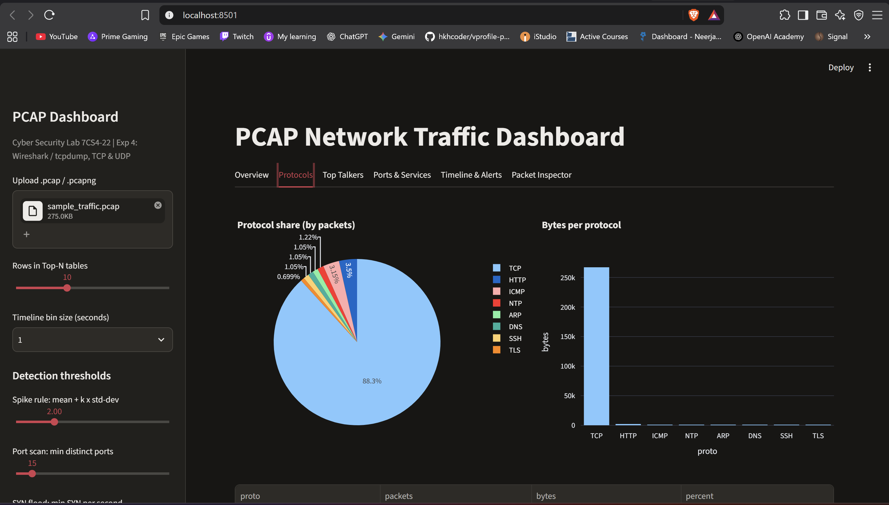
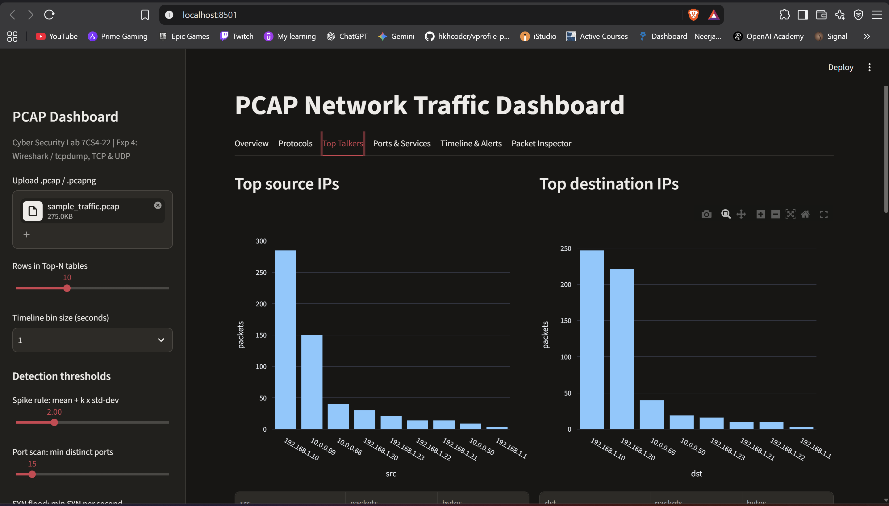
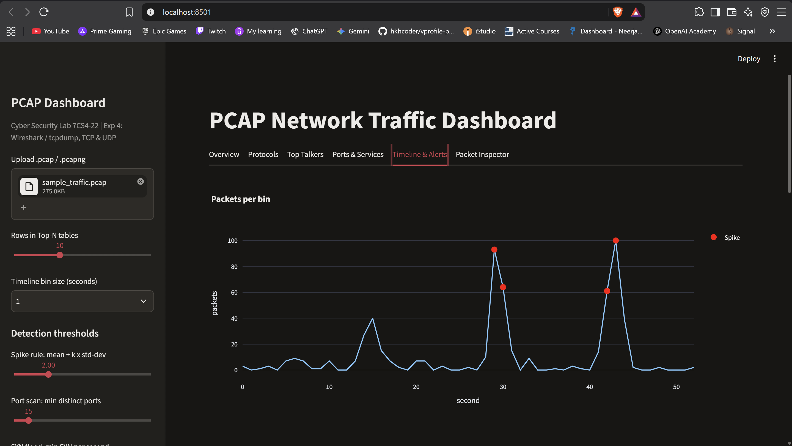
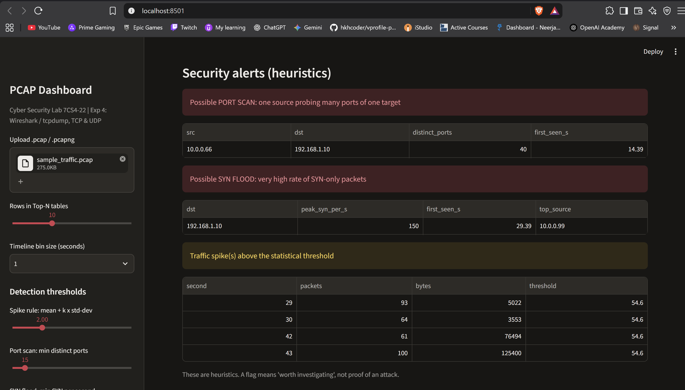

# PCAP Network Traffic Dashboard

A Python web dashboard that reads a `.pcap` / `.pcapng` capture file and shows its **protocol distribution**, **top talkers**, **active ports and services** and **traffic timelines**, with simple flags for port scans, SYN floods and traffic spikes.

Built with **pyshark** (a wrapper around Wireshark's `tshark`), **pandas**, **Plotly** and **Streamlit**.

| | |
|---|---|
| **Student** | Shamel Khan |
| **Roll No.** | 23ESKCS801 |
| **Class / Batch** | B.Tech VII Sem, CSE, Section D, Batch G1 (CS-D-G1), Session 2026-27 |
| **Project Code** | CSL-G23 |
| **Course** | Cyber Security Lab (7CS4-22), RTU Kota |
| **Linked experiment** | Experiment 4: Wireshark / tcpdump, TCP & UDP |
| **Institute** | Swami Keshvanand Institute of Technology, Management & Gramothan (SKIT), Jaipur |
| **Submitted to** | Vikash Dhankar, Assistant Professor, Dept. of CSE |

---

## Ethical disclaimer

This project is for **education only**. It analyses capture **files**; it does not capture or send any network traffic.

- The included `sample_traffic.pcap` is **synthetic**. It is generated by `generate_sample_pcap.py` and contains dummy traffic between private RFC 1918 addresses (`192.168.1.x`, `10.0.0.x`) with invented MAC addresses.
- Only analyse captures that you own or are authorised to analyse. Capturing or analysing other people's traffic without permission can be an offence under **Sections 43 and 66 of the Information Technology Act, 2000**.
- Uploaded files are written to a temporary file that is deleted right after parsing.

---

## Features

| Tab | What it shows |
|---|---|
| **Overview** | Total packets, data volume, capture duration, average packet rate, unique IPs |
| **Protocols** | Pie and bar charts and a table: TCP, UDP, ICMP, DNS, HTTP, TLS, SSH, NTP, ARP |
| **Top Talkers** | Top source IPs, top destination IPs, top IP pairs, merged conversations |
| **Ports & Services** | Most used TCP/UDP destination ports mapped to services (80 = HTTP, 443 = HTTPS, 53 = DNS ...) and TCP flag distribution |
| **Timeline & Alerts** | Packets-per-second and bytes-per-second graphs, spike markers, port scan and SYN flood alerts with adjustable thresholds |
| **Packet Inspector** | Searchable and filterable packet table, CSV export and TXT analysis report |

## Screenshots

| Overview | Protocols |
|---|---|
|  |  |

| Top talkers | Timeline |
|---|---|
|  |  |

| Security alerts |
|---|
|  |

---

## Installation and run guide

### 1. Prerequisites

- **Python 3.10 or newer**
- **Wireshark / TShark.** pyshark needs the `tshark` program.
  - **Windows:** install Wireshark from <https://www.wireshark.org/download.html>, keep **TShark** ticked, and add `C:\Program Files\Wireshark` to your `PATH`.
  - **Ubuntu / Debian:** `sudo apt install tshark`
  - **macOS:** `brew install wireshark`
- Check it works: `tshark -v`

### 2. Set up the project

```bash
git clone https://github.com/<your-username>/23ESKCS801_ShamelKhan_CSL-G23.git
cd 23ESKCS801_ShamelKhan_CSL-G23

python -m venv venv
venv\Scripts\activate            # Linux / macOS: source venv/bin/activate
pip install -r requirements.txt
```

### 3. Generate the safe sample capture (optional)

`sample_traffic.pcap` is already in the repository. To create it again:

```bash
python generate_sample_pcap.py
```

### 4. Start the dashboard

```bash
streamlit run app.py
```

The browser opens at <http://localhost:8501>. Upload `sample_traffic.pcap` from the sidebar.

### 5. Run the tests

```bash
python -m pytest -v
```

Expected result: **11 passed**.

### Troubleshooting

| Problem | Fix |
|---|---|
| `tshark` not found | Install Wireshark with TShark and add its folder to `PATH`, then open a new terminal |
| `No module named ...` | Activate the virtual environment (`venv\Scripts\activate`) and run `pip install -r requirements.txt` |
| `streamlit` is not recognised | Use `python -m streamlit run app.py` |

---

## Expected results for the sample capture

| Metric | Value |
|---|---|
| Packets / bytes / duration | 572 / 272,410 B / about 52 s |
| Unique IPs | 9 |
| Protocols | TCP 505, HTTP 20, ICMP 18, NTP 7, DNS 6, ARP 6, SSH 6, TLS 4 |
| SYN-only packets | 205 |
| Port scan alert | 10.0.0.66 to 192.168.1.10, 40 ports |
| SYN flood alert | 10.0.0.99 to 192.168.1.10, peak 150 SYN/s |

These numbers were cross-checked against Wireshark's *Capture File Properties*, *Protocol Hierarchy*, *Conversations* and *Endpoints* windows.

## How it works

```
upload / sample file
        |
        v
  app.py  (Streamlit UI) --> temporary file
        |
        v
  pcap_parser.py   pyshark -> tshark -> one DataFrame row per packet
        |
        v
  analysis.py      statistics, timeline, detection heuristics
        |
        v
  Plotly charts and tables, CSV / TXT export
```

- **pcap_parser.py** turns each packet into a row: time, length, source, destination, protocol, ports and TCP flags.
- **analysis.py** contains only calculations, so it can be tested without a browser.
- **app.py** only displays results.

### Detection heuristics

| Alert | Rule |
|---|---|
| Port scan | One source sends SYN-only packets to at least N different ports of the same target inside a sliding time window |
| SYN flood | A target receives at least N SYN-only packets within any one-second window |
| Traffic spike | A time bin is above mean + k x standard deviation (k is set in the sidebar) |

These are heuristics: an alert means "worth investigating", not proof of an attack.

## Project structure

```
23ESKCS801_ShamelKhan_CSL-G23/
|-- app.py                    Streamlit dashboard (UI only)
|-- pcap_parser.py            pyshark parsing -> DataFrame
|-- analysis.py               statistics and security heuristics
|-- generate_sample_pcap.py   creates the synthetic sample capture
|-- test_analysis.py          11 automated tests
|-- sample_traffic.pcap       safe synthetic capture (572 packets)
|-- requirements.txt
|-- docs/screenshots/         images used in this README
|-- .gitignore
`-- README.md
```

## Limitations and future scope

- Offline analysis only; no live capture. Large files are slow because pyshark builds a Python object per packet (the parser stops at 50,000 packets).
- Fixed, user-set thresholds; encrypted payloads cannot be inspected.
- Future work: live capture on an isolated lab network, GeoIP mapping, machine-learning anomaly detection, more detectors (DNS tunnelling, ARP spoofing).

## Academic note

Developed as an individual mini project for the Cyber Security Lab (7CS4-22) at SKIT Jaipur. Libraries used: pyshark, pandas, Plotly, Streamlit, scapy (sample generation only) and pytest.
